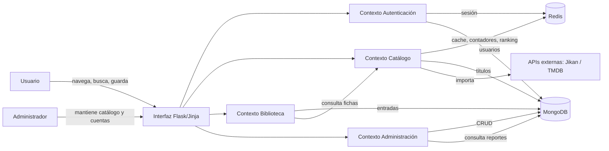
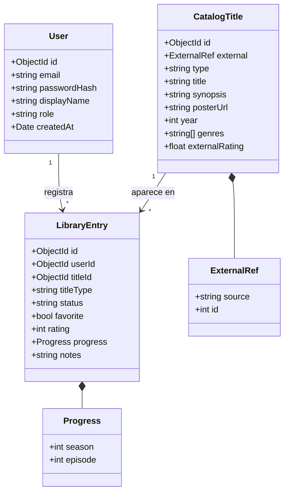
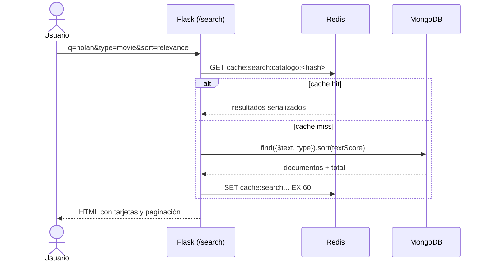
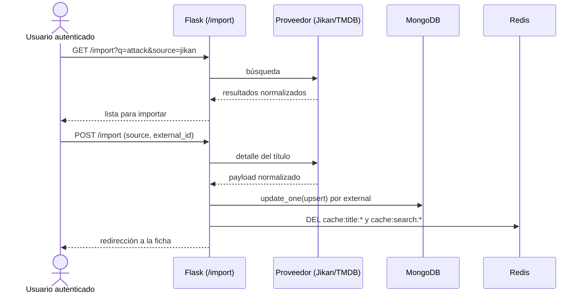
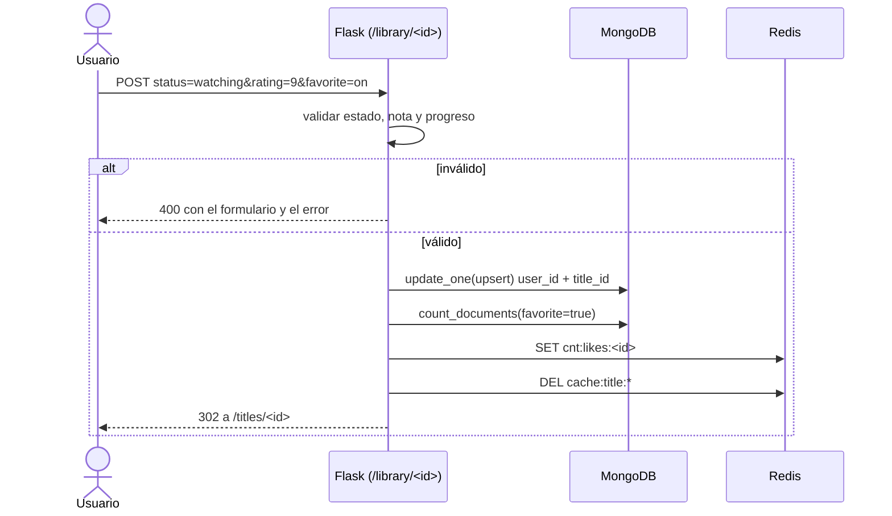
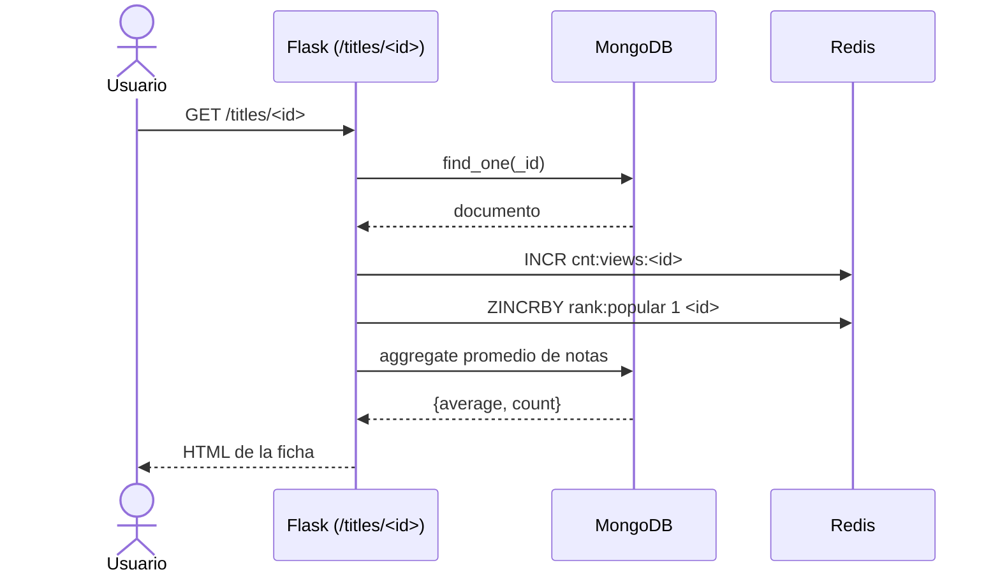

# Caso de Estudio 2 — Biblioteca virtual de películas, series y anime

**Materia:** Base de Datos 3
**Dupla 14:** Laura Mamani, Ivan Rios
**Stack:** Flask + Jinja, MongoDB 8.3, Redis 5.0
**Repositorio:** aplicación en `app/`, modelado en `mongodb/`, claves y notas de Redis en `redis/`

---

## 1. Introducción

El trabajo desarrolla una aplicación web de biblioteca virtual para películas,
series y anime. Un visitante puede explorar el catálogo, buscar por texto libre
y filtrar por tipo, género, año y valoración; un usuario registrado puede
guardar títulos en su biblioteca personal con un estado de seguimiento
(viendo, vista, pendiente, abandonada), marcarlos como favoritos, puntuarlos de
1 a 10 y registrar su progreso por temporada y episodio.

El catálogo no se carga a mano: el seed se genera desde fuentes abiertas
(Wikipedia en español e inglés, Wikidata e IMDb) y la aplicación también permite
importar títulos en vivo desde APIs externas (TMDB para películas y series,
Jikan para anime). MongoDB es la fuente de verdad; Redis se usa para sesiones,
cache de consultas, contadores y ranking de popularidad. Un panel de
administración permite mantener el catálogo y las cuentas sin tocar la base a
mano.

La entrega prioriza el **modelado NoSQL y el análisis de decisiones** por sobre
la cantidad de funcionalidades. Por eso la aplicación es deliberadamente
pequeña y cada pantalla existe para ejercitar una decisión de modelado:
documentos embebidos, referencias, índices, validadores, agregaciones y
cache-aside.

---

## 2. Contexto

El caso se enmarca en la materia Base de Datos 3, donde se estudian bases de
datos NoSQL orientadas a documentos y clave-valor. La consigna pide:

- una aplicación web con Flask y plantillas Jinja (sin SPA);
- MongoDB y Redis como únicas bases de datos;
- tres carpetas diferenciadas: `app/`, `mongodb/` y `redis/`;
- importación de títulos desde una API externa, con copia local;
- búsqueda híbrida: texto libre más facetas;
- perfiles de usuario y biblioteca personal con estados y puntuaciones;
- documentación con artefactos de Diseño Dirigido por el Dominio (DDD) y de
  metodología de modelado NoSQL.

El entorno de ejecución es local: MongoDB en `mongodb://localhost:27017`,
Redis en `redis://localhost:6379` y Python 3.14. La aplicación no depende de
servicios en la nube ni de un broker de mensajes. Para generar el seed sí se
consultan fuentes externas, pero el resultado queda versionado como JSON y la
aplicación funciona sin red.

---

## 3. Problema y objetivos

### 3.1 Problema

Una persona que consume películas, series y anime dispersa su seguimiento en
hojas de cálculo, notas y memoria. Al mismo tiempo, las APIs públicas ofrecen
fichas completas pero no una biblioteca personal. El problema es **unificar
catálogo, descubrimiento y seguimiento personal** en una sola aplicación,
manteniendo el catálogo actualizado sin duplicar títulos.

### 3.2 Objetivo general

Diseñar e implementar una biblioteca virtual con MongoDB y Redis, aplicando
DDD para delimitar el dominio y una metodología de modelado NoSQL basada en
patrones de acceso.

### 3.3 Objetivos específicos

1. Modelar usuarios, títulos y entradas de biblioteca como agregados con
   validación e índices.
2. Implementar búsqueda híbrida con índice de texto en español y filtros por
   tipo, género, año y nota.
3. Importar títulos desde Jikan y TMDB de forma idempotente.
4. Gestionar sesiones, cache, contadores y ranking en Redis.
5. Documentar mapa de contexto, agregados, eventos, servicios y escenarios.
6. Verificar el comportamiento con pruebas automatizadas y medir el uso de
   índices y el dimensionamiento.

### 3.4 Alcance

**Incluido:** catálogo, búsqueda, ficha, registro/login, biblioteca personal,
favoritos, notas, progreso, importación, APIs JSON de lectura, cache y ranking.

**Excluido:** reproducción de video, recomendaciones con machine learning,
moderación, pagos, notificaciones push, aplicación móvil y edición colaborativa
del catálogo.

---

## 4. Marco teórico

### 4.1 Diseño Dirigido por el Dominio (DDD)

DDD propone que el software se organice alrededor del **dominio**: el problema
real del negocio, expresado en un **lenguaje ubicuo** compartido por quienes
programan y quienes conocen el negocio. Sus piezas centrales son:

- **Entidad:** objeto con identidad propia y ciclo de vida (un título, un
  usuario).
- **Objeto de valor:** inmutable y definido por sus atributos (el progreso
  `{temporada, episodio}`, una valoración de 1 a 10).
- **Agregado:** grupo de objetos que se modifican juntos y que tiene una raíz
  con identidad. Las reglas de consistencia se validan dentro del agregado.
- **Contexto delimitado (bounded context):** frontera donde un modelo y su
  lenguaje tienen un significado preciso. Un mismo término puede significar
  cosas distintas en contextos distintos.
- **Evento de dominio:** hecho relevante que ya ocurrió (`TitleImported`,
  `EntryUpdated`).
- **Servicio de dominio:** operación que no pertenece naturalmente a una
  entidad y coordina varios agregados.

En este trabajo se identifican tres contextos: **Autenticación** (soporte),
**Catálogo** (núcleo) y **Biblioteca** (núcleo). La infraestructura Redis es
un contexto genérico de apoyo, no un contexto de negocio.

### 4.2 Metodología de modelado NoSQL

A diferencia del modelado relacional, que normaliza primero y consulta después,
el modelado NoSQL parte de las **consultas** y de las **formas de acceso**. La
metodología aplicada tiene cinco pasos:

1. **Identificar entidades y relaciones** a partir del dominio.
2. **Enumerar patrones de acceso** (lecturas y escrituras) con su frecuencia y
   volumen esperado.
3. **Decidir embedding o referencia** según cardinalidad, tamaño, ciclo de vida
   y frecuencia de lectura conjunta.
4. **Definir validación e índices** para sostener las consultas y la
   integridad.
5. **Dimensionar y verificar** con `explain()`, estadísticas de colección y
   pruebas de carga o de integración.

Reglas usadas en el caso:

- Se **embebe** lo que se lee siempre junto y tiene tamaño acotado: `external`,
  `genres` y `progress` dentro de su documento.
- Se **referencia** lo que tiene vida propia o cardinalidad N:M: `library_entries`
  apunta a `users` y a la colección del título (`movies`, `series` o `animes`).
- Se **desnormaliza** solo cuando el patrón de acceso lo justifica; por ejemplo,
  `year` se guarda como entero para filtrar y ordenar con un índice, y
  `title_type` se copia en la entrada de biblioteca para resolver el título sin
  recorrer las tres colecciones.
- La **unicidad** se garantiza con índices únicos (`users.email`, `external` por
  colección y `library_entries.user_id + title_id`), no solo con lógica de
  aplicación.

---

## 5. Desarrollo

### 5.1 Mapa de contexto



| Contexto | Tipo | Responsabilidad | Artefactos |
| --- | --- | --- | --- |
| Autenticación | Soporte | alta, login, logout, sesión, roles | `app/auth/` |
| Catálogo | Núcleo | títulos, búsqueda, ficha, importación | `app/catalog/` |
| Biblioteca | Núcleo | estados, favoritos, notas, progreso | `app/library/` |
| Administración | Soporte | CRUD de títulos y usuarios, dashboard, reportes | `app/admin/` |
| Infraestructura Redis | Genérico | sesión, cache, contadores, ranking | `app/cache.py`, `app/extensions.py` |

La relación entre Catálogo y Biblioteca es **cliente-proveedor**: Biblioteca
referencia títulos por `_id` y `title_type`, y no modifica el catálogo.
Autenticación es un contexto de soporte del que dependen los otros dos para
conocer al usuario; Administración agrupa las operaciones de mantenimiento y
solo está disponible para el rol `admin`.

### 5.2 Diagrama de dominio



`CatalogTitle` es una entidad abstracta: se materializa en tres colecciones
físicas (`movies`, `series`, `animes`) con la misma forma y un `type` fijo por
colección. Decisiones visibles en el diagrama:

- `ExternalRef` y `Progress` son **objetos de valor** embebidos.
- `LibraryEntry` es la raíz de un agregado que relaciona dos entidades.
- `role` distingue al administrador del usuario común sin una colección extra.
- `titleType` se copia en la entrada para resolver la ficha contra la colección
  correcta sin recorrer las tres.
- El estado y el favorito viven en la entrada, no en el título: son datos
  personales y cambian por usuario.

### 5.3 Agregados

#### Agregado `User`

| Elemento | Definición |
| --- | --- |
| Raíz | `User` (`_id`) |
| Invariantes | email único y con formato; contraseña con hash; nombre de 1–60 caracteres; rol en `admin` o `user` |
| Campos | `email`, `password_hash`, `display_name`, `role`, `avatar_url`, `created_at` |
| Operaciones | registrar, autenticar, consultar perfil, administrar cuentas |
| Persistencia | colección `users`, índice único `email` y índice por `role` |

**Entradas A–D**

- **A. Datos de alta:** nombre, email, contraseña en claro (solo en tránsito).
- **B. Credenciales de login:** email y contraseña.
- **C. Contexto de sesión:** cookie `sid` y TTL configurado.
- **D. Reglas:** formato de email, largo mínimo de contraseña, nombre máximo.

**Proceso A–B**

- **A. Validación y normalización:** recortar espacios, pasar email a
  minúsculas, verificar duplicados y generar `password_hash`.
- **B. Persistencia y sesión:** insertar el documento y crear `sess:<sid>` en
  Redis con el `user_id`.

**Salidas A–H**

| Salida | Contenido |
| --- | --- |
| A | Documento en `users` |
| B | Cookie `sid` `HttpOnly` |
| C | Hash en Redis con TTL |
| D | Redirección a la página pedida (`next`) o al inicio |
| E | Mensaje de error de validación o duplicado |
| F | Contexto `g.user` disponible para las plantillas |
| G | Formulario re-renderizado ante error |
| H | Registro de alta con `created_at` |

#### Agregado `CatalogTitle`

| Elemento | Definición |
| --- | --- |
| Raíz | `CatalogTitle` (`_id`), en la colección `movies`, `series` o `animes` |
| Invariantes | el `type` coincide con la colección; `external` único por fuente salvo títulos manuales; `year` entre 1900 y 2100; `genres` es un array de strings |
| Campos | `external`, `type`, `title`, `poster_url`, `synopsis`, `year`, `genres`, `external_rating`, `created_at`, `updated_at` |
| Operaciones | importar, crear/editar/eliminar desde el panel, buscar, ver ficha |
| Persistencia | tres colecciones, índice de texto, índices de facetas y único parcial de identidad externa |

**Entradas A–D**

- **A. Payload normalizado:** título, sinopsis, año, géneros, póster y nota
  externa, más `source` e `id`.
- **B. Criterios de búsqueda:** `q`, `type`, `genre`, `year_from`, `year_to`,
  `min_rating`, `sort`, `page`.
- **C. Identidad externa:** `source` e `id` para la idempotencia; `manual` para
  altas del panel.
- **D. Configuración:** TTL de cache, tamaño de página, idioma del índice.

**Proceso A–B**

- **A. Normalización:** año entero, géneros a array sin duplicados, sinopsis
  recortada, URL de póster validada.
- **B. Upsert y cache:** `update_one(upsert)` por `external.source + external.id`
  en la colección del tipo; invalidar `cache:title:*` y `cache:search:*`.

**Salidas A–H**

| Salida | Contenido |
| --- | --- |
| A | Documento en `movies`, `series` o `animes` (creado o actualizado) |
| B | Ficha HTML con sinopsis, géneros, nota externa y promedio de usuarios |
| C | JSON de `/api/titles/<id>` |
| D | Resultados paginados de `/search` y `/api/search` |
| E | Entradas de cache en Redis |
| F | Contador de visitas y posición en `rank:popular` |
| G | Errores de proveedor, duplicado o validación |
| H | `created_at` / `updated_at` para auditoría |

**Supuestos del catálogo**

- Un título pertenece a un solo tipo y no se mueve de colección al editarse.
- El año proviene de la categoría de Wikipedia y se contrasta con Wikidata.
- Los títulos manuales tienen `external: null` y no participan del índice único.
- Las notas externas están en escala 0–10.
- El catálogo esperado es de miles de documentos, no de millones.

#### Agregado `LibraryEntry`

| Elemento | Definición |
| --- | --- |
| Raíz | `LibraryEntry` (`_id`) |
| Invariantes | una entrada por usuario y título; `title_type` en enum; `status` en enum; `rating` 1–10 o nulo; `progress` con ambos campos |
| Campos | `user_id`, `title_id`, `title_type`, `status`, `favorite`, `rating`, `progress`, `notes` |
| Operaciones | guardar/actualizar, quitar, listar por estado, marcar favorito |
| Persistencia | colección `library_entries`, único `user_id + title_id`, índice por `title_type` |

**Entradas A–D**

- **A. Estado elegido:** viendo, vista, pendiente o abandonada.
- **B. Datos personales:** favorito, nota, progreso, notas.
- **C. Identidad:** usuario de la sesión y título de la ruta.
- **D. Reglas:** rangos de nota y progreso, largo de notas, estados válidos.

**Proceso A–B**

- **A. Validación:** estado en enum; nota entera 1–10; temporada y episodio
  juntos y positivos; notas de hasta 500 caracteres.
- **B. Upsert y sincronización:** escribir la entrada y recalcular
  `cnt:likes:<title_id>` desde MongoDB; invalidar la ficha cacheada.

**Salidas A–H**

| Salida | Contenido |
| --- | --- |
| A | Documento en `library_entries` |
| B | Página “Mi biblioteca” filtrada por estado |
| C | Contadores por estado |
| D | Badge de estado en la ficha |
| E | Contador de favoritos en Redis |
| F | Promedio de notas recalculado en la ficha |
| G | Errores de validación (400) |
| H | `updated_at` y redirección a la ficha |

**Supuestos de la biblioteca**

- Un usuario tiene como máximo una entrada por título.
- El progreso solo aplica a series y anime, pero se acepta en cualquier tipo.
- El favorito es independiente del estado.
- La nota personal no modifica la nota externa del título.

#### Resumen de decisiones de embedding y referencia

| Dato | Decisión | Motivo |
| --- | --- | --- |
| `external {source, id}` | embeber en el título | identidad externa del documento |
| `genres` | embeber en el título | se leen con la ficha, tamaño acotado |
| `progress {season, episode}` | embeber en `library_entries` | objeto de valor pequeño |
| Usuario y título en la entrada | referenciar | entidades con vida propia, relación N:M |
| `title_type` | desnormalizar en `library_entries` | resolver la colección del título con un solo `find_one` |
| Contadores y ranking | Redis | datos derivados, alta escritura, bajo costo de reconstrucción |

### 5.4 Eventos de dominio

Los eventos se modelan como **hechos del lenguaje ubicuo** y se implementan
como efectos dentro de la misma transacción de solicitud; no hay broker. Esta
decisión es adecuada para el alcance y se documenta como límite.

| Evento | Disparador | Consumidor / efecto |
| --- | --- | --- |
| `UserRegistered` | alta exitosa | crear sesión Redis, redirigir |
| `UserLoggedIn` | credenciales válidas | crear sesión Redis |
| `UserLoggedOut` | logout | borrar `sess:<sid>` y cookie |
| `TitleImported` | importación desde API | invalidar cache de fichas y búsquedas |
| `TitleCreated` | alta manual desde el panel | invalidar cache de fichas y búsquedas |
| `TitleUpdated` | edición desde el panel | invalidar cache de fichas y búsquedas |
| `TitleDeleted` | borrado desde el panel | eliminar entradas de biblioteca e invalidar cache |
| `TitleViewed` | `GET /titles/<id>` | `INCR cnt:views` y `ZINCRBY rank:popular` |
| `EntrySaved` | alta/edición de biblioteca | sincronizar `cnt:likes`, invalidar ficha |
| `EntryDeleted` | borrado de biblioteca | recalcular `cnt:likes`, invalidar ficha |
| `RatingChanged` | nota personal guardada | promedio recalculado en la próxima lectura |
| `UserManaged` | alta/edición/borrado desde el panel | actualizar `users` y, al borrar, su biblioteca |

### 5.5 Servicios de dominio

| Servicio | Responsabilidad | Implementación |
| --- | --- | --- |
| Autenticación | validar credenciales, crear/destruir sesión | `app/auth/routes.py`, `app/auth/session.py` |
| Búsqueda de catálogo | interpretar filtros, construir consulta, paginar entre tres colecciones | `app/catalog/services.py` |
| Importación | consultar proveedor, normalizar, upsert idempotente | `app/catalog/providers.py`, `app/catalog/importer.py` |
| Biblioteca | validar y persistir entradas, listar por estado | `app/library/services.py` |
| Administración | CRUD de títulos y usuarios, dashboard, reportes | `app/admin/services.py`, `app/admin/routes.py` |
| Cache y ranking | cache-aside, contadores, sorted set | `app/cache.py` |
| Promedio de notas | agregación sobre `library_entries` | `average_rating()` en `app/catalog/services.py` |

Los servicios no conocen HTTP: reciben documentos o diccionarios y devuelven
documentos o resultados. Las rutas se ocupan de la sesión, la validación de
formularios y la respuesta HTML/JSON.

### 5.6 Diagramas de escenario

#### Escenario 1 — Búsqueda híbrida



#### Escenario 2 — Importación desde API



#### Escenario 3 — Guardar en la biblioteca



#### Escenario 4 — Visita a una ficha



---

## 6. Implementación

### 6.1 Arquitectura

La aplicación usa el patrón **application factory** de Flask. `create_app()`
carga configuración, registra los blueprints `auth`, `catalog`, `library` y
`admin`, inyecta el usuario de la sesión en `g` y expone `/health`.

```text
caso de estudio 2/
├─ app/
│  ├─ __init__.py          # factory, blueprints, contexto de usuario
│  ├─ config.py            # .env, Mongo, Redis, APIs
│  ├─ extensions.py        # clientes Mongo y Redis por aplicación
│  ├─ cache.py             # claves, cache-aside, contadores, ranking
│  ├─ run.py               # punto de entrada
│  ├─ auth/                # registro, login, logout, sesión Redis, roles
│  ├─ catalog/             # búsqueda, ficha, APIs, proveedores, importador
│  ├─ library/             # estados, favoritos, notas, progreso
│  ├─ admin/               # dashboard, CRUD de títulos y usuarios, reportes
│  ├─ templates/           # Jinja: base, index, search, detail, import, admin/*
│  └─ static/css/style.css
├─ mongodb/
│  ├─ init/                # validadores, índices y limpieza legacy
│  ├─ seed/                # generador de datos, JSON y cargadores
│  ├─ aggregations/        # reportes del informe
│  └─ queries/             # explain y dimensionamiento
├─ redis/
│  └─ README.md            # mapa de claves y operación
├─ tests/                  # 121 pruebas automatizadas
└─ docs/
   └─ informe.md           # este documento
```

### 6.2 Rutas

| Método | Ruta | Descripción | Auth |
| --- | --- | --- | --- |
| GET | `/` | inicio: tendencias, mejores notas, recientes | no |
| GET | `/search` | búsqueda híbrida paginada | no |
| GET | `/titles/<id>` | ficha con sinopsis, géneros y promedio | no |
| GET | `/api/search` | búsqueda en JSON | no |
| GET | `/api/titles/<id>` | ficha en JSON con promedio | no |
| GET | `/api/popular` | ranking de visitas desde Redis | no |
| GET | `/import` | buscador de APIs externas | sí |
| POST | `/import` | importa y redirige a la ficha | sí |
| GET | `/auth/register` | formulario de alta | no |
| POST | `/auth/register` | crea usuario y sesión | no |
| GET | `/auth/login` | formulario de login | no |
| POST | `/auth/login` | valida y crea sesión | no |
| POST | `/auth/logout` | destruye la sesión | no |
| GET | `/library` | biblioteca personal filtrable | sí |
| GET | `/profile` | perfil con estadísticas personales | sí |
| POST | `/library/<id>` | alta o edición de entrada | sí |
| POST | `/library/<id>/delete` | quita la entrada | sí |
| GET | `/admin` | dashboard con métricas del catálogo | admin |
| GET | `/admin/titles` | listado y filtros del catálogo | admin |
| GET/POST | `/admin/titles/new` | alta manual de un título | admin |
| GET/POST | `/admin/titles/<id>/edit` | edición de un título | admin |
| POST | `/admin/titles/<id>/delete` | baja de un título y sus entradas | admin |
| GET | `/admin/users` | listado de cuentas | admin |
| GET/POST | `/admin/users/new` | alta de una cuenta | admin |
| GET/POST | `/admin/users/<id>/edit` | edición de cuenta y rol | admin |
| POST | `/admin/users/<id>/delete` | baja de una cuenta y su biblioteca | admin |
| GET | `/admin/reports` | reportes de catálogo y actividad | admin |
| GET | `/health` | chequeo de salud | no |

### 6.3 Búsqueda híbrida

`parse_filters()` normaliza los parámetros y `build_filter()` construye el
documento de consulta. Si hay texto, se usa `$text` con el índice
`text_busqueda`; el orden por defecto es `$meta: textScore`. Los filtros de
tipo, género, año y nota se combinan con AND. La paginación es fija en 12
resultados. Cuando no se filtra por tipo, la consulta recorre `movies`,
`series` y `animes` y combina los resultados en memoria antes de ordenar y
paginar.

Pesos del índice de texto: título 10, sinopsis 3, géneros 1. El índice usa
`default_language: "spanish"` para que el stemming funcione en español
(`correr` encuentra `corriendo`).

### 6.4 Datos del catálogo e importación idempotente

El catálogo inicial se genera con `mongodb/seed/fetch_catalog.py`, que combina
cuatro fuentes sin clave:

1. **Wikipedia en español:** categorías por año (`Películas de {año}`,
   `Series de televisión iniciadas en {año}`, `Anime de {año}`) para obtener
   títulos y sinopsis.
2. **Wikidata:** `P345` (IMDb), `P136` (género), `P577` (fecha) y el enlace a
   la Wikipedia inglesa.
3. **Wikipedia en inglés:** póster cuando la versión española no tiene imagen.
4. **IMDb:** `title.ratings.tsv.gz` para la nota y el volumen de votos.

El resultado se guarda en `mongodb/seed/data/{movies,series,animes}.json` con
solo `source`, `external_id`, `title`, `image`, `synopsis`, `year`, `genres` y
`rating`. `load_seed.py` transforma esos JSON al esquema de las cinco
colecciones y hace `update_one(upsert)` por `external.source + external.id`,
preservando `created_at` con `$setOnInsert`.

La importación en vivo usa el mismo principio: los proveedores Jikan y TMDB
devuelven un payload normalizado y `app/catalog/importer.py` decide la colección
según el tipo. TMDB requiere `TMDB_API_KEY`; Jikan no requiere clave. La
importación en vivo se verificó con payloads grabados en las pruebas y
`python -m mongodb.seed.import_external` queda disponible para ejecutarla con
red.

### 6.5 Redis: sesión, cache, contadores y ranking

El detalle del mapa de claves está en `redis/README.md`. Resumen:

- `sess:<sid>` — hash con `user_id`, TTL de 7 días.
- `cache:search:<db>:<hash>` — resultados serializados, TTL 60 s.
- `cache:title:<db>:<id>` — ficha + promedio, TTL 300 s.
- `cache:api:<db>:<hash>` — resultados de búsqueda externa, TTL 600 s.
- `cnt:views:<id>` y `cnt:likes:<id>` — contadores enteros.
- `rank:popular` — sorted set de visitas por título.

La invalidación es explícita al importar y al modificar la biblioteca; las
búsquedas además expiran por TTL. El cliente usa `protocol=2` porque el build
5.0.14.1 de Redis para Windows no soporta `HELLO 3`.

### 6.6 Validación e índices

Los validadores JSON Schema de `mongodb/init/01_collections.js` exigen los
campos obligatorios, tipos y enums, y usan `additionalProperties: false` en las
cinco colecciones. El validador de cada colección de catálogo fija además su
`type`, de modo que `movies` no acepte documentos de tipo `series`. Esto obliga
a declarar cada campo nuevo y evita documentos con forma irregular.

Los índices de `mongodb/init/02_indexes.js` cubren texto, facetas, orden,
unicidad y búsquedas por usuario. El índice de texto se recrea con
`dropIndex` para fijar el idioma español, porque `createIndex` no modifica las
opciones de un índice existente. El índice único de identidad externa es
parcial (`external` de tipo objeto) para que los títulos manuales con
`external: null` no colisionen entre sí. `mongodb/init/03_drop_legacy.js`
elimina la colección `titles` de versiones anteriores.

### 6.7 Pruebas

La suite usa `pytest` y crea bases `catalogo_test_*` y la base 15 de Redis por
fixture. `tests/support.py` concentra el catálogo determinístico de 16 títulos
y los helpers de inicialización, sin `conftest.py`. Cubre:

- salud de la aplicación y conexión a Mongo/Redis;
- validadores de las cinco colecciones, índices y limpieza legacy;
- carga del catálogo, usuarios y bibliotecas demo, con idempotencia;
- sesiones Redis (creación, lectura, expiración, destrucción);
- registro, login, logout, rol asignado y redirección con `next`;
- búsqueda por texto, filtros, orden, paginación y promedio;
- rutas HTML y APIs JSON;
- proveedores, importador y rutas de importación;
- biblioteca: alta, edición, borrado, validación y filtros;
- panel de administración: permisos, CRUD y reportes;
- cache, contadores, ranking e invalidación;
- agregaciones, `explain()` y dimensionamiento.

```powershell
python -m pytest -q
```

---

## 7. Análisis de resultados

### 7.1 Catálogo y seed

El seed inicial tiene 16 títulos:

| Tipo | Cantidad |
| --- | --- |
| Películas | 4 |
| Series | 5 |
| Anime | 7 |
| **Total** | **16** |

La distribución permite ejercitar las tres ramas del polimorfismo y las
facetas de tipo. La importación permite ampliar el catálogo sin cambiar el
modelo.

### 7.2 Planes de ejecución

Salida de `mongodb/queries/report_queries.js` sobre el catálogo local:

| Consulta | Etapa | nReturned | Claves examinadas | Documentos examinados | ms |
| --- | --- | --- | --- | --- | --- |
| `texto_libre` (`drama`) | `TEXT_MATCH` | 10 | 10 | 10 | 3 |
| `filtro_tipo_anio` (series desde 2010) | `FETCH <- IXSCAN` | 3 | 3 | 3 | 1 |
| `genero_tipo` (anime + Acción) | `FETCH <- IXSCAN` | 4 | 4 | 4 | 1 |
| `biblioteca_usuario` | `FETCH <- IXSCAN` | 0 | 0 | 0 | 1 |
| `favoritos_usuario` | `FETCH <- IXSCAN` | 0 | 0 | 0 | 1 |

Lectura: en todas las consultas `nReturned == totalKeysExamined ==
totalDocsExamined`. No hay exámenes de documentos de más ni colecciones
recorridas completas (`COLLSCAN`). La consulta de texto usa el índice invertido
y las demás usan índices compuestos o parciales.

### 7.3 Dimensionamiento

Salida de `mongodb/queries/sizing.js`:

| Colección | Documentos | Tamaño medio | Almacenamiento | Índices | Tamaño de índices |
| --- | --- | --- | --- | --- | --- |
| `titles` | 16 | 736 B | 24 KB | 7 | 144 KB |
| `library_entries` | 0 | — | 4 KB | 5 | 20 KB |
| `users` | 0 | — | 4 KB | 2 | 8 KB |

Los índices ocupan más que los datos porque el catálogo es mínimo. Con el
crecimiento esperado (miles de títulos), la proporción se estabiliza y el
costo dominante pasa a ser el índice de texto. El dimensionamiento se incluye
como método reproducible, no como conclusión sobre un volumen grande.

### 7.4 Cache y ranking

- La búsqueda repetida con los mismos filtros se resuelve desde Redis sin
  tocar MongoDB (`cache:search`).
- La ficha JSON se cachea 5 minutos (`cache:title`); se invalida al importar o
  al cambiar la biblioteca.
- Cada visita a una ficha incrementa `cnt:views` y `rank:popular`; la home
  muestra “Tendencias” a partir de ese sorted set.
- `cnt:likes` se recalcula desde MongoDB en cada cambio de entrada, lo que
  evita desviaciones por escrituras concurrentes o borrados.
- Las búsquedas externas (Jikan/TMDB) se cachean 10 minutos (`cache:api`) y se
  invalidan al importar, para no repetir llamadas a la API.
- `/api/popular` expone el ranking con el número de visitas; `/profile` resume
  la biblioteca del usuario con una agregación por estado, favoritos y nota
  media personal.

### 7.5 Pruebas y calidad

La suite completa pasa con **121 pruebas**. Los fallos corregidos durante el
desarrollo quedaron cubiertos por pruebas de regresión:

- el índice de texto no aplicaba stemming en español hasta fijar
  `default_language`;
- los validadores rechazaban `_id` hasta declararlo en `additionalProperties`;
- redis-py 8 fallaba con `HELLO` hasta fijar RESP2;
- `upsert_entry` fallaba porque `title_type` aparecía en `$set` y en
  `$setOnInsert` a la vez; quedó solo en `$set`;
- la suite seguía dependiendo de `titles.json`; se reemplazó por
  `tests/support.py` con un catálogo determinístico de 16 títulos;
- el login no respetaba `next` hasta agregar el parámetro a la ruta y al
  formulario;
- el panel de administración necesitó pruebas propias de permisos, duplicados y
  protección del último administrador.

### 7.6 Límites y trabajo futuro

- **Dependencia de fuentes externas para regenerar el seed:** Wikipedia,
  Wikidata e IMDb imponen límites de peticiones; el generador reintenta y
  respeta `Retry-After`, pero una regeneración completa puede tardar. El
  catálogo ya generado queda versionado, así que la aplicación no depende de
  la red para arrancar.
- **Importación en vivo:** quedó preparada y probada con payloads grabados;
  falta ejecutarla contra las APIs reales en un entorno con salida a internet.
- **Sin broker de eventos:** los eventos son efectos sincrónicos; una cola
  permitiría desacoplar contadores y notificaciones.
- **Cache con invalidación por prefijo:** usa `SCAN`; en una instancia grande
  convendría versionar claves o usar tags.
- **Búsqueda:** no hay tolerancia a errores ortográficos ni sinónimos; se
  podría evaluar Atlas Search o un índice adicional.
- **Recomendaciones:** el modelo actual permitiría calcularlas con agregaciones
  sobre `library_entries`, pero quedan fuera del alcance.
- **Seguridad:** faltan límite de intentos de login, verificación de email y
  rotación de sesión.

---

## 8. Conclusiones

El caso permitió aplicar DDD y modelado NoSQL en un dominio acotado pero
completo. Las decisiones principales fueron:

1. **Separar contextos** (Autenticación, Catálogo, Biblioteca, Administración)
   evitó mezclar datos personales con datos del catálogo y dejó claro qué
   agregado posee cada invariante.
2. **Separar el catálogo por tipo** en `movies`, `series` y `animes` mantuvo
   documentos homogéneos y validadores estrictos; la identidad externa y los
   índices de texto se repiten por colección.
3. **Embeber lo que se lee junto y referenciar lo que tiene vida propia**
   produjo un modelo simple: cinco colecciones, sin duplicar fichas por usuario.
4. **Modelar desde las consultas** justificó los índices compuestos, el índice
   de texto en español y el índice parcial de favoritos. Los planes de
   ejecución confirman que las consultas usan índices y examinan solo lo
   necesario.
5. **Redis no reemplaza a MongoDB**: se usó para lo que hace bien (sesión,
   cache, contadores, ranking) y MongoDB siguió siendo la fuente de verdad.
6. **La idempotencia** por identidad externa y la unicidad por índices
   evitaron duplicados sin depender solo de la lógica de la aplicación.
7. **Las pruebas automatizadas** fueron el mecanismo para descubrir y fijar
   decisiones delicadas (idioma del índice, RESP2, validadores, `next`,
   conflictos de `$set`/`$setOnInsert`).

Como aprendizaje, el modelado NoSQL exige explicitar supuestos y patrones de
acceso; cuando eso se hace, el esquema resultante es más pequeño y predecible
que una traducción directa del modelo relacional.

---

## 9. Bibliografía

- Evans, E. (2003). *Domain-Driven Design: Tackling Complexity in the Heart of
  Software*. Addison-Wesley.
- Vernon, V. (2013). *Implementing Domain-Driven Design*. Addison-Wesley.
- Fowler, M. (2015). *Microservices Patterns* / artículos sobre bounded context
  y agregados. https://martinfowler.com
- MongoDB. *Data Modeling Guide*.
  https://www.mongodb.com/docs/manual/data-modeling/
- MongoDB. *Text Indexes*.
  https://www.mongodb.com/docs/manual/core/index-text/
- MongoDB. *JSON Schema Validation*.
  https://www.mongodb.com/docs/manual/core/schema-validation/
- MongoDB. *Aggregation Pipeline*.
  https://www.mongodb.com/docs/manual/core-aggregation-pipeline/
- Redis. *Data types* y *EXPIRE*.
  https://redis.io/docs/latest/develop/data-types/
- Redis. *Sorted sets*.
  https://redis.io/docs/latest/develop/data-types/sorted-sets/
- Pallets Projects. *Flask Documentation*.
  https://flask.palletsprojects.com/
- PyMongo. *Documentation*.
  https://pymongo.readthedocs.io/
- redis-py. *Documentation*.
  https://redis-py.readthedocs.io/
- Jikan. *Jikan API v4*.
  https://docs.api.jikan.moe/
- TMDB. *API Documentation*.
  https://developer.themoviedb.org/docs
- Wikimedia. *MediaWiki API* y *Wikidata Query Service*.
  https://www.mediawiki.org/wiki/API:Main_page · https://query.wikidata.org/
- IMDb. *Datasets*.
  https://datasets.imdbws.com/
